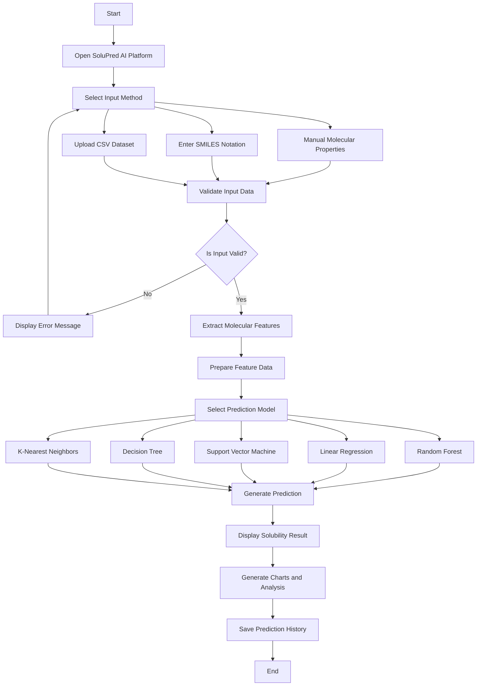

# SoluPred AI – Real-Time ML Solubility Prediction Platform

<p align="center">
  <strong>An intelligent platform for predicting molecular solubility using machine learning.</strong>
</p>

## 1. Project Overview

**SoluPred AI** is a machine-learning-based platform designed to predict the solubility of chemical compounds. It provides an easy-to-use interface where users can enter molecular properties, submit SMILES notation, or upload datasets to obtain solubility predictions.

The platform also provides visual dashboards, model comparisons, prediction history, and data analysis to help users understand the results.

## 2. Problem Statement

Solubility prediction is an important task in chemistry, pharmaceutical research, and drug development.

Traditional laboratory testing can require significant time, resources, and repeated experiments. Researchers need a simple digital platform that can help estimate the solubility of compounds and understand their molecular properties.

## 3. Proposed Solution

SoluPred AI provides a web-based platform that uses machine-learning models to estimate molecular solubility.

Users can:
- Enter molecular properties manually.
- Provide SMILES notation.
- Upload CSV datasets.
- Generate solubility predictions.
- Compare machine-learning models.
- View charts and analysis.
- Access previous prediction records.

## 4. System Workflow

The following workflow uses standard Mermaid syntax and is designed to render on GitHub.



### Workflow Explanation

1. The user opens the SoluPred AI platform.
2. The user chooses manual input, SMILES notation, or CSV upload.
3. The system validates the submitted information.
4. Molecular features are prepared for prediction.
5. A machine-learning model is selected.
6. The model generates a solubility prediction.
7. Results and visualizations are displayed.
8. The prediction can be saved in the history.

## 5. Key Features

### Real-Time Prediction
- Predict molecular solubility using available input features.
- Display prediction results through the web interface.
- Support manual molecular property input.

### Multiple Input Options
- Manual molecular property entry.
- SMILES notation input.
- CSV dataset upload.

### Machine Learning Models

The platform includes the following model options:

| Model | Description |
|---|---|
| Random Forest | Uses multiple decision trees to generate predictions. |
| Linear Regression | Estimates relationships between molecular features and solubility. |
| Support Vector Machine | Uses support vectors to model prediction patterns. |
| Decision Tree | Makes predictions using decision rules. |
| K-Nearest Neighbors | Uses nearby data points to estimate results. |

### Data Visualization
- Solubility prediction charts.
- Model performance comparison.
- Molecular feature analysis.
- Actual vs predicted values.
- Prediction history and trends.

### Dashboard
The dashboard provides a central view of:
- Total predictions.
- Model performance.
- Recent prediction activity.
- Solubility distribution.
- Analysis charts.

## 6. Molecular Input Features

The platform uses molecular properties such as:

| Feature | Description |
|---|---|
| MolLogP | Estimates the lipophilicity of a molecule. |
| MolWt | Represents molecular weight. |
| NumRotatableBonds | Counts rotatable bonds in a molecule. |
| AromaticProportion | Represents the proportion of aromatic atoms. |

**SMILES:** Simplified Molecular Input Line Entry System. It represents a molecular structure using text.

Example:

```text
CCO
```

This is the SMILES representation of ethanol.

## 7. Model Performance

The following scores were reported in the project description:

| Machine Learning Model | Reported Score |
|---|---:|
| Random Forest | 85.7% |
| Linear Regression | 78.3% |
| Support Vector Machine | 82.1% |
| Decision Tree | 79.8% |
| K-Nearest Neighbors | 81.5% |

**Note:** These are reported project values, not independently verified results. Before presenting them as actual model performance, specify the evaluation metric, dataset, train-test split, and validation method. For a regression task, R², MAE, and RMSE are generally more informative than an undefined accuracy percentage.

## 8. Technology Stack

### Frontend
- HTML5
- CSS3
- JavaScript
- Tailwind CSS
- Chart.js
- Font Awesome

### Backend and Data
- REST API
- JSON
- CSV data handling
- Prediction history storage
- Model performance storage

### Machine Learning
- Random Forest
- Linear Regression
- Support Vector Machine
- Decision Tree
- K-Nearest Neighbors

**Implementation note:** Confirm which models are genuinely trained and connected to the application. If a model currently uses simulated predictions, describe it as a simulation rather than a trained machine-learning model.

## 9. Application Modules

### Module 1 – Dashboard
Displays the overall platform summary, prediction statistics, and visualizations.

### Module 2 – Real-Time Prediction
Allows users to enter molecular properties and obtain a prediction.

### Module 3 – Upload Dataset
Allows users to upload CSV files for data processing and analysis.

### Module 4 – ML Analysis
Provides model comparison, feature analysis, and performance visualizations.

## 10. Data Storage

The application can maintain the following records.

### Prediction History

| Field | Description |
|---|---|
| id | Unique prediction ID |
| molecule_name | Name of the compound |
| molecular_features | Input molecular properties |
| predicted_value | Predicted solubility |
| model_name | Selected model |
| created_at | Prediction date and time |

### Model Performance

| Field | Description |
|---|---|
| id | Unique record ID |
| model_name | Model name |
| performance_score | Recorded performance |
| evaluation_metric | Metric used |
| updated_at | Last update time |

## 11. API Endpoints

The project description includes the following API route patterns:

| Method | Endpoint | Purpose |
|---|---|---|
| GET | `/tables/prediction_history` | Retrieve prediction history |
| POST | `/tables/prediction_history` | Save a prediction |
| GET | `/tables/model_performance` | Retrieve model performance |
| GET | `/tables/{table_name}` | Retrieve records from a supported table |

Verify these routes against the actual backend implementation before publishing them as active API endpoints.

## 12. How to Run the Project

### Step 1 – Clone the Repository

```bash
git clone YOUR_GITHUB_REPOSITORY_URL
```

### Step 2 – Open the Project Folder

```bash
cd SoluPred-AI
```

### Step 3 – Install Dependencies

Install the dependencies required by your actual project.

For a Python backend, if a `requirements.txt` file is available:

```bash
pip install -r requirements.txt
```

### Step 4 – Start the Application

Run the backend using the command specified in your project configuration.

For a simple Flask application:

```bash
python app.py
```

### Step 5 – Open the Platform

Open the local application URL shown by your development server.

For example:

```text
http://127.0.0.1:5000
```

**Note:** Update these commands according to your actual project structure and backend framework.

## 13. Suggested Project Structure

```text
SoluPred-AI/
│
├── frontend/
│   ├── index.html
│   ├── style.css
│   ├── script.js
│   └── assets/
│
├── backend/
│   ├── app.py
│   ├── routes/
│   ├── models/
│   └── database/
│
├── datasets/
│   └── sample_data.csv
│
├── notebooks/
│   └── model_experiments.ipynb
│
├── requirements.txt
├── .gitignore
├── .env.example
└── README.md
```

This is a suggested structure. Adjust it to match the files in your actual repository.

## 14. Future Enhancements

- Integration with RDKit for molecular feature extraction.
- Support for additional molecular input formats.
- Model retraining with updated datasets.
- Cross-validation and hyperparameter tuning.
- Explainable AI using SHAP or LIME.
- Confidence intervals for predictions.
- Improved model evaluation and monitoring.
- User authentication and personalized prediction history.
- Advanced molecular visualization.

## 15. Responsible Use

SoluPred AI is intended as a research and educational support platform.

Its predictions should be treated as estimates, not confirmed experimental results. Users should validate important findings through reliable scientific methods and laboratory testing.

## 16. Conclusion

SoluPred AI brings molecular solubility prediction, machine-learning model analysis, and data visualization together in one platform.

It aims to make solubility estimation easier to explore, understand, and analyze through a simple and interactive interface.

---

## 17. Author and Project Information

**Project Name:** SoluPred AI  
**Category:** Machine Learning / Chemistry / Data Science  
**Project Type:** Web-Based Prediction Platform  
**Purpose:** Molecular Solubility Prediction  

---

<p align="center">
  <strong>SoluPred AI</strong><br>
  Predict. Analyze. Understand.
</p>
